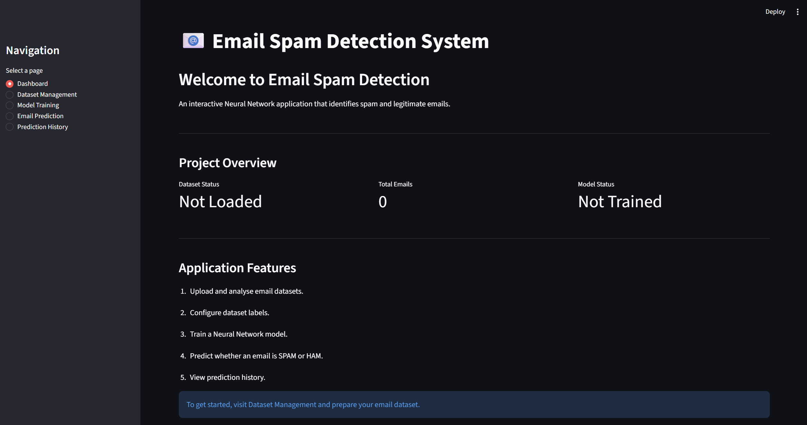
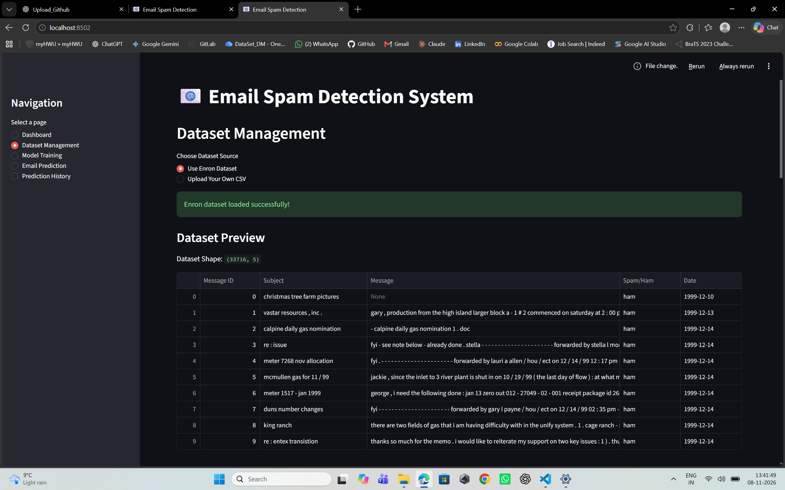
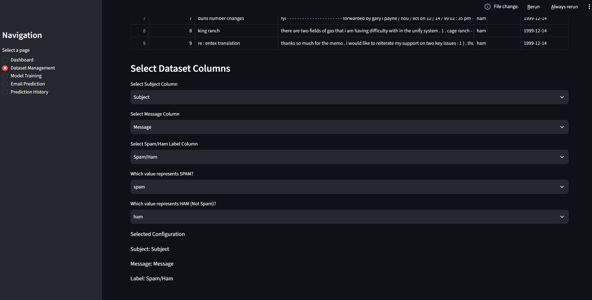
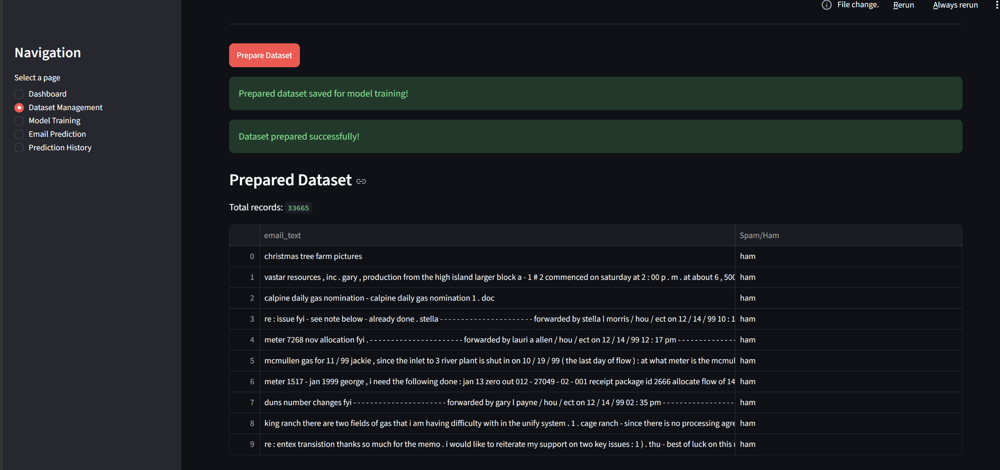
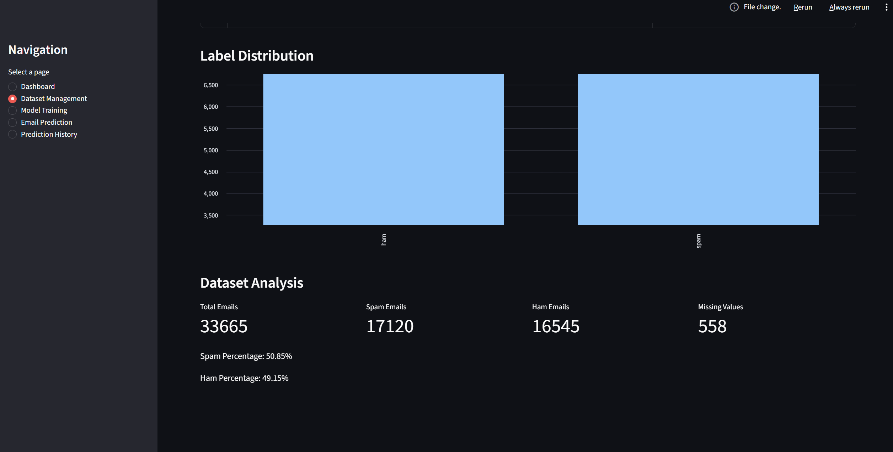
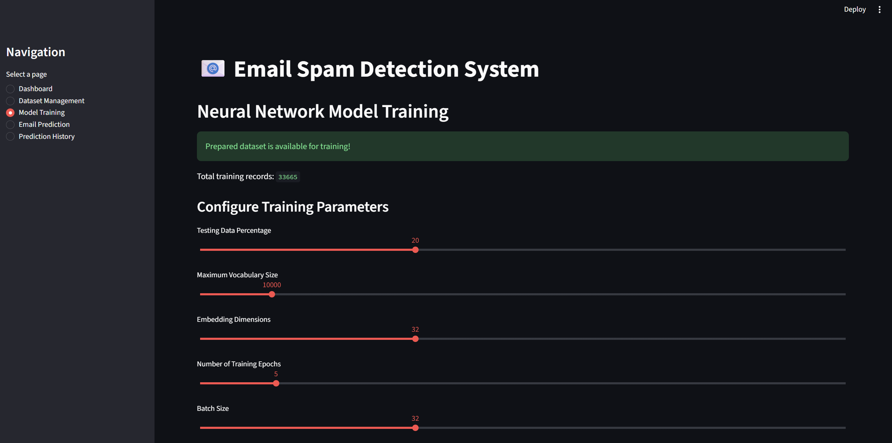
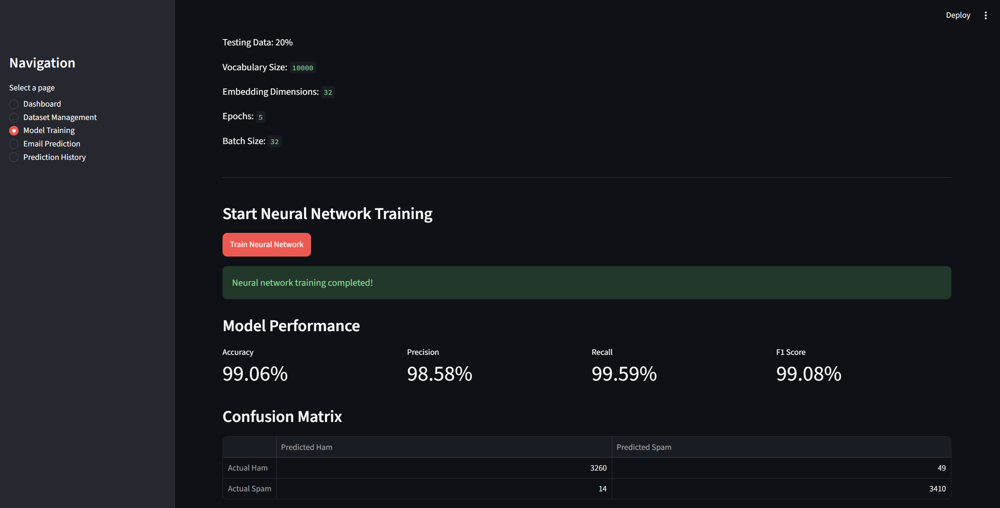
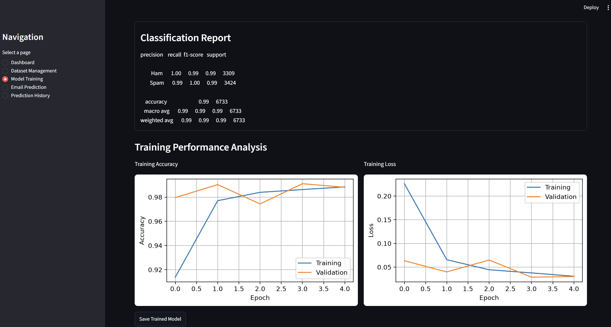
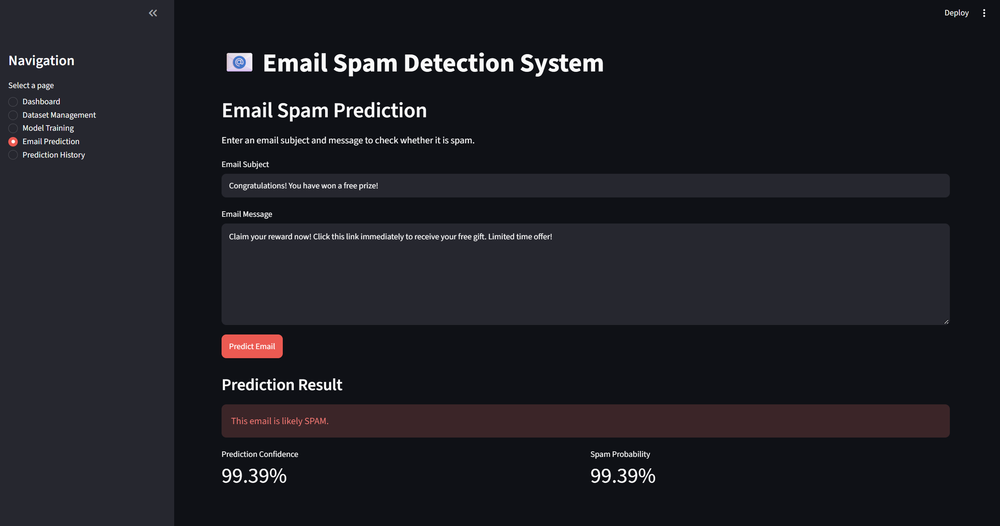

# Email Spam Detection System

An interactive Email Spam Detection System built using a Neural Network and Streamlit. The application analyzes email content and predicts whether an email is **SPAM** or **HAM (Not Spam)**.

## Project Overview

This project uses Natural Language Processing (NLP) and a TensorFlow/Keras neural network to classify emails.

Users can upload their own email datasets, configure dataset labels, train a neural network, evaluate its performance, and test individual emails through an interactive web application.

## Features

- Interactive Streamlit dashboard
- Upload custom CSV email datasets
- Select and configure text and label columns
- Automatic email text preparation
- SPAM and HAM label mapping
- Dataset analysis and visualization
- Configurable neural network training
- Training accuracy and loss graphs
- Model evaluation using:
  - Accuracy
  - Precision
  - Recall
  - F1-score
  - Confusion matrix
  - Classification report
- Save and load trained models
- Predict whether an email is SPAM or HAM
- Display prediction confidence and spam probability
- In-app prediction history
## Application Screenshots

### Dashboard


### Dataset Management





### Model Training




### Email Prediction


## Technologies Used

- Python
- TensorFlow and Keras
- Pandas
- NumPy
- Scikit-learn
- NLTK
- Matplotlib
- Seaborn
- Streamlit

## Project Structure

```text
Email-Spam-Detection/
│
├── data/
├── models/
├── notebooks/
├── src/
│   ├── preprocess.py
│   ├── train.py
│   └── predict.py
│
├── app.py
├── requirements.txt
├── .gitignore
└── README.md
```

## Dataset

The project supports CSV email datasets containing email text and spam/ham labels.

The application allows users to select their own dataset and map the appropriate columns and label values.

The Enron email dataset was used for initial development and testing.

## Installation and Setup

### 1. Clone the repository

```bash
git clone YOUR_GITHUB_REPOSITORY_URL
```

### 2. Navigate to the project folder

```bash
cd Email-Spam-Detection
```

### 3. Create a virtual environment

```bash
python -m venv venv
```

### 4. Activate the virtual environment

Windows:

```bash
venv\Scripts\activate
```

### 5. Install dependencies

```bash
pip install -r requirements.txt
```

### 6. Add your dataset

Place your CSV email dataset inside the `data` folder.

### 7. Run the application

```bash
streamlit run app.py
```

The application will open in your web browser.

## Model Evaluation

The neural network is evaluated using multiple classification metrics, including accuracy, precision, recall, and F1-score.

A confusion matrix and classification report are also provided to help understand the model's performance.

Actual results may vary depending on the dataset and training configuration.

## Future Improvements

- Support additional email datasets
- Improve text preprocessing
- Experiment with different neural network architectures
- Add persistent prediction history
- Improve model comparison and evaluation
- Explore deployment options

## Author

Developed as a Neural Network project using Python and Streamlit.
